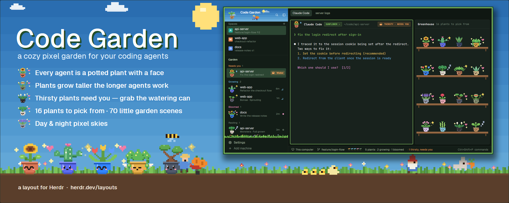

# 🌱 Code Garden

**A cozy pixel garden for your coding agents, as a layout for [Herdr](https://herdr.dev).**

Every agent becomes a little potted house plant with a face. It sways while the agent works, droops and asks for water when it needs you, blooms when it's done, and dozes off when it's idle. The longer an agent works, the taller its plant grows. Above it all is a pixel sky that follows the time of day, where worms, gnomes, ducks and a gardener with a wheelbarrow wander by now and then.



## What's in it

- 🪴 **A plant for every agent.** Claude is a sunflower, Codex a cactus, OpenCode a snake plant, Hermes a pothos in a winged pot, Antigravity tulips, and everything else a sprout.
- 🌻 **16 plants to choose from.** Click the plant badge in any pane header (`SUNFLOWER ⌄`) to pick another: monstera, Boston fern, aloe, lavender, rose, bonsai, Venus flytrap, orchid, lucky bamboo, peace lily and more.
- 💧 **Moods that match the agent's status:**
  - working: growing, with a sun and rising sparkles
  - needs you: thirsty, drooping, with a blinking water drop
  - done: bloomed, hopping with a heart
  - idle: resting, then snoozing, then a bee comes to wake it
- 📈 **Plants grow** from Seedling to Sprouting, Leafy and Full grown as their agent's total working time adds up.
- 🚿 **A watering can button** on agents that need you. Click it to jump straight to them.
- 🌅 **Day and night pixel skies**: dawn, a sunny day with drifting clouds, dusk, and a starry night with a moon and fireflies.
- 🐌 **70 little garden scenes** under the title, one every few minutes. Worm races, ant parades, gnome conga lines, whack-a-mole, a duck family outing, a hot air balloon… Click the strip to play one now.
- 📋 **Two-line sidebar rows**, so branch names and agent titles never get cut off.
- 🌾 **A garden-bed status bar**: one tiny sprout per agent in its status colour.

Everything else (terminals, tabs, splits, keys, the Files and Changes panels) works exactly as in Herdr's default layout.

## Install

### With your agent

Ask your coding agent: *"Add the Herdr layout from https://github.com/jparkerweb/herdr-layout--code-garden"*. Herdr's own instructions tell agents how to install a shared layout, and `RECIPE.md` explains everything this one does.

### With the install script

```sh
git clone https://github.com/jparkerweb/herdr-layout--code-garden
cd herdr-layout--code-garden
./install.sh          # macOS / Linux / Git Bash
.\install.ps1         # Windows PowerShell
```

The script copies the layout, theme and mods into `~/.config/herdr-app` (or `$HERDR_APP_HOME`). It runs `herdr-app check` on each mod and switches to the layout. It won't overwrite anything that already exists. To update an earlier Code Garden install, use `--update` (`-Update` in PowerShell). To install without switching, use `--no-switch` (`-NoSwitch`).

### By hand

Copy `layouts/`, `themes/` and `mods/` into `~/.config/herdr-app/`, then:

```sh
herdr-app do layout.switch --name code-garden
```

Your own layout stays as it was. `Ctrl+Shift+L` switches between layouts.

## Make it yours

- **See every plant in every mood:** `herdr-app do mod.open --name garden-gallery`
- **Draw or add plants:** each plant is an ASCII pixel map in `mods/garden-agents/plant.js` (`SPECIES`). `plant.js` is copied into `garden-pane`, `garden-chrome` and `garden-gallery` too, because Herdr mods can't share files. Copy it to all four after editing.
- **Add scenes:** `mods/garden-chrome/scenes.js`. Sprites are in `S` and scenes in `SCENES`; a new scene is one line.
- **Colours:** `themes/code-garden.json`.

## Uninstall

Switch to another layout, then delete `layouts/code-garden.*`, `themes/code-garden.json` and `mods/garden-*` from `~/.config/herdr-app`.

## Notes

- Built and tested on Herdr 0.1.17.
- Nothing reaches the network. The spaces list runs read-only `git` commands and `hc machine ls`, as Herdr's own spaces list does.
- Several mods started as copies of Herdr's shipped mods (Apache-2.0); see [NOTICE](NOTICE).

## License

[Apache-2.0](LICENSE)
