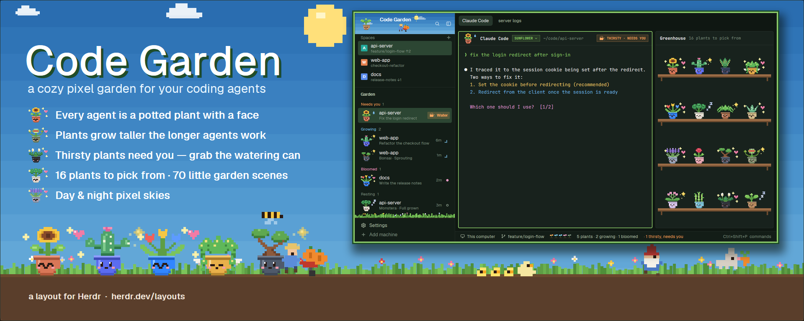

# Code Garden

A cozy pixel-art garden for Herdr. Every coding agent is a little potted house plant with a face on its pot. The plant sways while the agent works, droops when it needs you, blooms when it's done, and dozes when it's idle. Plants grow taller the longer their agent works. You pick each agent's plant from 16 species. The sidebar sits under a day/night pixel sky, where small garden scenes play now and then: worms, gnomes, a gardener with a wheelbarrow, ducks and more. The terminals and agents themselves work exactly as in Herdr's default layout; only the look changes.

## What you see

Left to right: a 268px sidebar, then the work column.

**Sidebar** (`chrome` `#131d17`), top to bottom:

- **Sky header, 58px.** Horizontal pixel bands that follow the local hour:
  - dawn 5–8: `#2b2d5c` → `#eea36f`, low orange sun
  - day 8–17: `#2a6db0` → `#6cadda`, yellow sun with pulsing rays, two translucent clouds drifting
  - dusk 17–20: `#1f1d48` → `#e8875a`
  - night: `#0b1026` → `#20305a`, 14 twinkling stars, a crescent moon, two fireflies

  On the left is a 36px "sprout" plant (resting by day, snoozing at night). Next to it is "Code Garden" in white, 14px semibold. Under the title is a 22px **scene strip**. On the right are search and sidebar buttons in `#ffffffcc`.
- **Spaces list.** Each space is a 2px-radius letter avatar, then two lines: the name (13px, line height 17px) and, under it, the repo / branch / ↑ahead ↓behind (11px, line height 14px, `dim`). Rows are 40px with a tail, 30px without.
- **Garden list** (the agents), weight 1.4. Its header shows a pixel sprig and "Garden". Sections are Needs you / Bloomed / Growing / Resting (or grouped by space). Each 42px row has:
  - a 32px plant
  - two lines: the name, then the tab or agent title, or "Sunflower · Seedling"
  - the time in that state
  - a status mark: three animated bars for working, a pink dot for done, a ring for idle, and an orange "Water" button with a pixel watering can for blocked
- **Footer, 88px.** A 16px pixel grass strip (blades 4–12px, the odd flower) with a butterfly drifting along it, a 2px soil line `#3D2A1E`, then Settings and Add machine.

**Work column:**

- **Tab bar**: Herdr's shipped `tabs`, 42px.
- **Panes**: 4px radius, a 1px `border`, and a 2px `accent` border when focused.
- **Pane header, 38px**, for each pane:
  - the agent's 30px plant, or a wooden `>_` sign for shells
  - the name in JetBrains Mono bold
  - a clickable plant badge (`SUNFLOWER ⌄`, in `accent`)
  - the folder
  - a status tag: GROWING (bars), THIRSTY · NEEDS YOU (watering can), BLOOMED, RESTING
  - split, zoom and close buttons on hover
- **Status bar, 28px.** Machine, branch, then a "garden bed" with one 9×10 sprout per agent in its status colour (working ones sway, blocked ones blink), then "N plants · N growing · N bloomed · N thirsty, needs you" and the palette key.

**Theme** `code-garden` (dark forest):

- background `#18221d`, foreground `#e6ecd9`, accent `#8fcf6a`, canvas `#0f1712`
- working `#7cc4f0` (water), blocked `#f5a35c`, done `#f29cc8` (blossom), idle `#7d8f7f`
- the layout's background is a `#0f1712` → `#142219` gradient

## How it behaves

**Plants.** Each plant is a 30×22-pixel canvas: the pot is in rows 13–21, the foliage above it, and six columns on the right hold props. The plant species comes from the agent's program:

| Program | Plant |
|---|---|
| Claude | sunflower |
| Codex | cactus |
| OpenCode | snake plant |
| Hermes | pothos (in a winged pot) |
| Antigravity | tulips |
| Anything else | sprout |

The other ten (monstera, Boston fern, aloe, lavender, rose, bonsai, Venus flytrap, orchid, lucky bamboo, peace lily) are there to pick.

**Moods** follow the agent's status:

| Status | Mood | What it looks like |
|---|---|---|
| working | growing | leaves sway (900 ms), a sun pulses, sparkles rise |
| blocked < 1 min | thirsty | foliage droops, a water drop blinks (640 ms), worried face, a sweat drop |
| blocked ≥ 1 min | very thirsty | droops further, two drops blink at 320 ms |
| done | bloomed | the plant hops (320 ms), a heart floats, sparkles twinkle, ^^ eyes |
| idle | resting | eyes closed, a slow 2.6 s breeze |
| idle ≥ 2 min | snoozing | Zzz drift up |
| idle ≥ 5 min | bee alarm | a bee buzzes back and forth; the plant trembles, wide eyes |

**Growth.** The agents list adds up each agent's total working time and keeps it across restarts. The stages are Seedling (0), Sprouting (2 min), Leafy (6 min) and Full grown (15 min). A young plant's foliage sits 6 / 4 / 2 pixels down in the pot and is clipped at the rim.

**Clicks:**

- **Plant badge** in a pane header: opens a popup with all 16 plants plus Automatic (the plant for that agent's program). Picking one closes it and changes that agent's plant everywhere.
- **Watering can** in a Garden row: focuses that agent's pane.
- **Garden row**: focuses the agent's pane. Clicking the plant of an agent with sub-agents folds them.
- **Garden-bed sprout** in the status bar: focuses that agent.
- **Scene strip**: plays a new scene now.
- Everything else (tabs, menus, keys, Files and Changes panels) is Herdr's default.

**Scenes.** 70 scenes, with about 50 sprite kinds at 2px per sprite pixel. The first plays 6 s after load, then one plays every 2–4 minutes. They come from a shuffled deck, so all 70 play before any repeats. An actor either crosses the strip one way (a native `left` transition, 4–40 s; optionally right-to-left, mirrored) or stays put, fading in or rising out of the ground. Legs, wings, bobbing and glowing are native loops. Hovering the strip shows the scene's name.

**The sky** checks the hour once a minute.

## Built from

- `layouts/code-garden.json`: a copy of Herdr's `main` layout with `theme: "code-garden"`, `preview: "layouts/code-garden.svg"` and the gradient background. The node tree:
  - `sidebar` (268px)
    - `brand`: `garden-chrome`, 58px
    - `sidebar-lists`
      - `spaces`: `garden-spaces`
      - `agents`: `garden-agents`, weight 1.4
    - `sidebar-footer`: `garden-chrome` with props `{footer: true}`, 88px
  - `work`
    - `tabs`: the shipped `tabs`
    - `work-body`
      - `main`: `{tab: "active"}` with a pane frame of gap 8, radius 4, `garden-pane` header 38px
      - `panel`: the shipped `files` / `changes`, hidden
    - `status`: `garden-status`, 28px
- `themes/code-garden.json`: 16 ANSI colours plus `colors` overrides for the panel colours and statuses.
- `mods/garden-agents`: a clone of the shipped `agents`.
  - `plant.js` is the sprite engine. `SPECIES` holds the ASCII pixel maps per plant (`head` and `leaves` layers and a `pot` palette). It exports `plantMood(mood, height, {species, growth, still, pace})`, `mood(status, waited)`, `chosenSpecies`, `choosePlant`, `stageFor`, `growthOf`, `plantPicker`, `wateringCan` and `ALL_SPECIES`.
  - Shared state: `garden.plants` ({terminal address → species}) and `garden.growth` ({address → stage 0–3}, written only when a stage changes).
  - `localStorage`: `changed`, `worked`, `pins`.
  - Calls `setAgentOrder`, `pane.focus`, `agent.focus`, `terminal.pin`, `terminal.peek` and `layout.resize`.
- `mods/garden-pane`: a pane header cloned from the shipped `pane`. The plant badge opens `openOverlay({mod: "garden-pane", kind: "popup", width: 392, height: 372, props: {plantPicker: terminal, key: programKey}})`, and that copy draws the picker.
- `mods/garden-spaces`: a clone of the shipped `spaces` with the git tail moved to a second line. Like the shipped mod, it **runs `git`** (read-only `rev-parse`, `symbolic-ref`, `rev-list`) in each space's folder, and **`hc machine ls`**.
- `mods/garden-chrome`: the brand header and footer, cloned from `workspace-chrome`.
  - `scenes.js` holds the sprites (`S`) and scenes (`SCENES`). It exports `drawScene(scene, phase, width, play)` and `sceneLength`. Phases go start → go (after 120 ms) → out (after the scene's length) → gone.
  - Also has the sky (`SKIES`, `skyLayer`) and the grass (`GRASS`).
- `mods/garden-status`: the status bar, rewritten from `workspace-status`.
- `mods/garden-gallery`: optional, not in the layout. `herdr-app do mod.open --name garden-gallery` shows every plant in every mood and growth stage.
- Icons: `mods/workspace-chrome/*.svg` (shipped with Herdr), plus `settings`, `plus`, `search` and `sidebar` in `garden-chrome` and the pane buttons in `garden-pane`.
- Nothing reaches the network. Nothing reads files outside Herdr's home.

## Watch out

- **Elements are single-use.** Adding one element to two parents fails the whole render ("element `div` was already added to a parent"). Build each repeated widget from a function.
- **Loop periods must be at least 100 ms.** One fast wing flap below that breaks the view when that scene comes up. `scenes.js` clamps every loop and bob with `Math.max(100, …)`.
- **Popups size to their content.** A `flex_1().min_h(0)` scroll area inside a popup collapses to zero height, and the picker opens empty. The picker has a fixed width and no flex filling.
- **Off-stage actors widen the strip.** Actors waiting at `width + 2` made the strip measure wider every frame, which grew without limit. The scene layer is absolutely positioned and clipped, and the measured width is clamped to 40–420.
- **Transitions need a fresh id per play** (`scene-${play}-${i}`), or a new scene inherits the last one's end position.
- **`plant.js` is copied into four mods** (`garden-agents`, `garden-pane`, `garden-chrome`, `garden-gallery`), because a mod can't import another mod's files. Edit it in `garden-agents` and copy it to the other three; the four copies must match.
- **`setShared` in render** only when a value actually changed. Otherwise every mod re-renders forever.
- **Plant choices are kept per terminal address.** A new agent terminal starts on Automatic. Growth starts at Seedling for agents that were running before this layout was installed.
- **Scenes ignore the sky**, so bats can fly at noon. Night-only scenes would be an easy addition.
- **The sky hours are fixed** (5 / 8 / 17 / 20). They don't follow real sunrise or sunset.
- Built and checked on **Herdr 0.1.17** (Windows). The layout and mods record `cloned_from` 0.1.17.

## Done when

- `herdr-app check mods/<name>` passes for `garden-chrome`, `garden-spaces`, `garden-agents`, `garden-pane`, `garden-status` and `garden-gallery`.
- `herdr-app do layout.switch --name code-garden` shows the sky header, two-line spaces, the Garden list with a plant per agent, and the grass footer. `herdr-app status` lists no errors.
- A working agent's plant sways with a sun. A blocked one droops with a blinking drop and a Water button, and clicking Water focuses its pane. A finished one hops with a heart.
- Clicking a pane header's plant badge opens a popup showing all 16 plants plus Automatic. Picking Rose changes that agent's plant in the pane header, the Garden list and the status bar.
- An agent that has worked 6 minutes in total shows "Leafy", and its foliage sits 2 pixels lower than full grown.
- Clicking the scene strip plays a scene, and its actors move across in one direction. Hovering shows its name.
- `herdr-app do mod.open --name garden-gallery` shows 16 rows of plants with no broken view.
